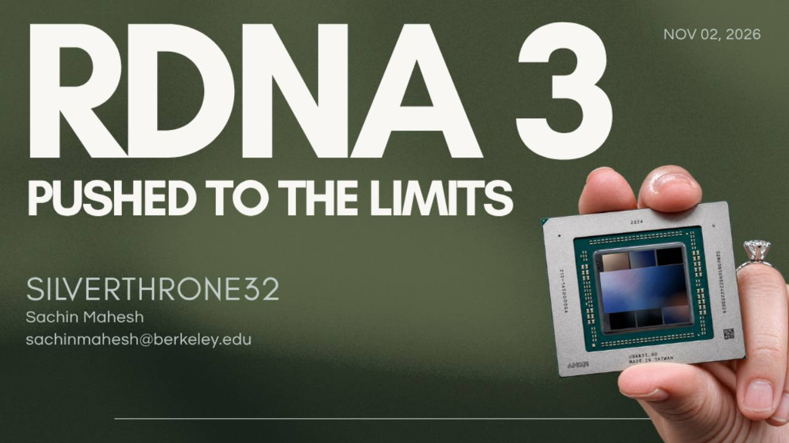

# Qwen Rotated INT4 on AMD RDNA3

**Up to 2.27x prefill and 1.53x decode over stock Q4_K_M on the RX 7900 XT.**

**11,012 tokens/s prefill on 4B. 6,624 on 9B. 50.1 tokens/s decode on 27B.**

A llama.cpp fork that runs rotated GPTQ INT4 weights directly on RDNA3's INT4 WMMA hardware. It combines custom matrix kernels, fused activation packing, recurrent attention optimizations and a shorter decode graph to accelerate Qwen3.5-4B, Qwen3.5-9B and Qwen3.8-27B. **No MTP or speculative decoding.**

Developed by [Sachin Mahesh / SILVERTHRONE32](https://github.com/SILVERTHRONE32).

[Paper](docs/rdna3/papers/rdna3_int4_report.pdf) | [Build and run](docs/rdna3/REPRODUCE.md) | [Kernel profiles](docs/rdna3/PROFILING.md) | [Results archive](docs/rdna3/README.md)

## Performance on the RX 7900 XT

| Model | Prefill pp512 | Prefill pp2048 | Decode |
|---|---:|---:|---:|
| **Qwen3.5-4B** | **11,012** | **10,624** | **200.6** |
| **Qwen3.5-9B** | **6,624** | **6,561** | **126.2** |
| **Qwen3.8-27B** | **2,013** | **1,930** | **50.1** |

All rates are tokens/s. Fast prefill preset; 27B decode is the observed peak. Results: [latest report, Tables 4, 6 and 7](docs/rdna3/papers/rdna3_int4_report.pdf#page=6).

For 4B, that is **2.01x the prefill** and **1.38x the decode** of the same-checkpoint Q4_K_M baseline. With the quality prefill preset, the gain is **1.30x prefill** at essentially the same perplexity degradation as Q4_K_M, with lower KLD and lower VRAM use. The 9B fast path reaches **2.20x prefill / 1.32x decode**, and 27B reaches **2.27x / 1.53x**. See [the report](docs/rdna3/papers/rdna3_int4_report.tex#L214).

### GPU comparison

All rates are tokens/s. Prefill is pp512; decode comparison runs use tg128. The XT uses this fork's fast INT4 path. External GPU figures come from the paper's comparison table; the external 27B entries use IQ4_XS.

| GPU | 4B prefill | 4B decode | 9B prefill | 9B decode | 27B prefill | 27B decode |
|---|---:|---:|---:|---:|---:|---:|
| RTX 5090 | 16,036 | 313.6 | 11,721 | 220.5 | 3,213 | 81.8 |
| RTX 4090 | 14,882 | 220.2 | 9,762 | 141.6 | 2,510 | 49.8 |
| **RX 7900 XT, this work** | **11,012** | **200.6** | **6,624** | **126.2** | **2,013** | **50.1** |
| RTX 5080 | 10,057 | 200.5 | 6,543 | 136.1 | 1,673 | 49.4 |
| RTX 5070 Ti | 8,889 | 187.6 | 5,872 | 126.0 | 1,276 | 42.1 |
| RTX 5070 | 7,449 | 154.5 | 4,652 | 101.3 | - | - |
| RTX 3090 | 7,366 | 179.1 | 4,632 | 122.1 | 1,042 | 43 |
| RTX 5060 Ti 16 GB | 4,776 | 107.6 | 2,955 | 70.0 | 815 | 27.6 |

The XT leads the 5080 in 4B prefill and matches its decode. On 9B, it exceeds the 5080's prefill and reaches the 5070 Ti's decode rate. On 27B, it reaches 50.1 tokens/s decode versus the 5080's 49.4, with **20% higher prefill** (2,013 versus 1,673).

Source: [latest report, Table 1](docs/rdna3/papers/rdna3_int4_report.pdf#page=4). Dashes indicate unavailable measurements.

## What makes it fast

### Rotation and GPTQ

A block-Hadamard rotation spreads activation outliers across groups of 256 channels. GPTQ then quantizes the rotated weights to symmetric INT4. The runtime applies the matching rotation to activations, packs them into the kernel's operand layout, and executes `v_wmma_i32_16x16x16_iu4` directly.

The **quality** preset evaluates 8-bit activations through two INT4 passes. The **fast** preset uses one pass with 4-bit activations. Both use the same rotated INT4 weights. Decode uses 8-bit activations under both presets.

### Prefill

- **INT4 WMMA GEMMs** with operand layouts and tile sizes tuned for the model's matrix shapes, including a four-wave kernel for large weights.
- **Fused RMS normalization, rotation and activation packing**, reducing intermediate reads and launches.
- **Chunked WMMA gated-delta-net** and **WMMA Flash Attention** for the hybrid Qwen attention stack.
- **GDN gate and output fusions**, including the 27B model's 48-head path and a zero-spill skinny matmul.

### Decode

- **Fused matvec prologues and epilogues**, with normalization, residuals and rotations folded into surrounding operations where possible.
- **Attention combine folded into the tile kernel**. The 4B path drops from **847 to 236 kernel launches per token**.
- **Compact 4-bit group scales and raw-buffer weight reads** to reduce decode memory traffic.
- **Four-row rotated output matvecs** tuned for the 27B dimensions.
- **An IQ4_XS vocabulary head** for 27B and **batched small host-input uploads** to reduce head bandwidth and token-boundary synchronization.

Source: [INT4 kernels](ggml/src/ggml-cuda/int4-wmma.cu), [attention combine](ggml/src/ggml-cuda/fattn-tile.cuh), [skinny matmul](ggml/src/ggml-cuda/mm-skinny-rdna3.cu), and [input scheduling](ggml/src/ggml-backend.cpp). [Profiles](docs/rdna3/PROFILING.md) rank the remaining decode and prefill costs and document the launch-gap investigation.

## Accuracy and memory

The two prefill presets expose a measurable speed/accuracy tradeoff. On Qwen3.5-4B, against its BF16 reference:

| Path | pp512 | Decode | PPL change | KLD |
|---|---:|---:|---:|---:|
| Q4_K_M | 5,477 | 145.2 | +2.00% | 0.0278 |
| Rotated INT4, quality | 7,140 | 200.7 | +1.92% | 0.0241 |
| Rotated INT4, fast | 11,012 | 200.6 | +8.67% | 0.0969 |

The quality preset's peak VRAM is **3,358 MiB**, versus **3,621 MiB** for Q4_K_M. Weight prepacking retains a single weight copy. Accuracy is evaluated on 24 WikiText-2 test chunks at context 512; the BF16 reference has PPL 8.837. See [the paper's accuracy table](docs/rdna3/papers/rdna3_int4_report.tex#L214).

On **9B**, quality / fast PPL changes are **+1.27% / +4.50%**, with KLD **0.0188 / 0.0713**. On **27B**, they are **+1.27% / +4.55%**, with KLD **0.0184 / 0.0565**. Reported peak VRAM is **5,463 MiB** for 9B quality and **15,893 MiB** for 27B quality. See [Table 6](docs/rdna3/papers/rdna3_int4_report.pdf#page=8) and [Table 7](docs/rdna3/papers/rdna3_int4_report.pdf#page=9).

## Build and run

The measured setup uses **ROCm 10.1, gfx1100 and 12 CPU threads**. Start with the [build instructions](docs/rdna3/REPRODUCE.md), which also cover generating the IQ4_XS head cache from the existing 27B GGUF.

With the build, rotated checkpoint and head cache available locally:

```bash
export INT4_BIN="$PWD/build-rdna3/bin"
export INT4_MODEL=/path/to/qwen38-27b-rotq4-gptq.gguf
export INT4_HEAD=/path/to/head_iq4_xs.bin

# Prefill and plain decode
examples/rdna3-int4/run.sh llama-bench -p 512,2048 -n 0 -r 5 -o json
examples/rdna3-int4/run.sh llama-bench -p 0 -n 128 -r 5 -o json

# OpenAI-compatible inference server
examples/rdna3-int4/serve.sh
```

The server exposes `qwen3.8-27b-int4` at `http://127.0.0.1:8080/v1`.

## Paper, measurements and reproduction

- [Qwen INT4 paper](docs/rdna3/papers/rdna3_int4_report.pdf) and [LaTeX source](docs/rdna3/papers/rdna3_int4_report.tex): method, quality results, kernel development and GPU comparisons.
- [Profiling report](docs/rdna3/PROFILING.md): latency-sorted operations, scratch/register use, host synchronization and launch gaps.
- [Research archive](docs/rdna3/README.md): benchmark commands, samples, accuracy logs, candidate kernels and raw traces.
- [Quantization tools](docs/rdna3/quantization): rotation, GPTQ and the layerwise 27B workflow.
- [Stock ROCm 7.2 / 10.1 comparison](docs/rdna3/results/stock-rocm/README.md): controlled local SDK comparison.

Built on [llama.cpp](https://github.com/ggml-org/llama.cpp) and [ggml](https://github.com/ggml-org/ggml). The original project documentation is preserved in [README-upstream.md](README-upstream.md). Code is provided under the [MIT license](LICENSE).

## Additional model support

Also added INT4 acceleration for **Ossicle 4B**: **10,934 tokens/s prefill (pp512)** and **200.6 tokens/s decode (tg128)** on the RX 7900 XT. See the [paper's Ossicle 4B results](docs/rdna3/papers/rdna3_int4_report.tex#L243).
